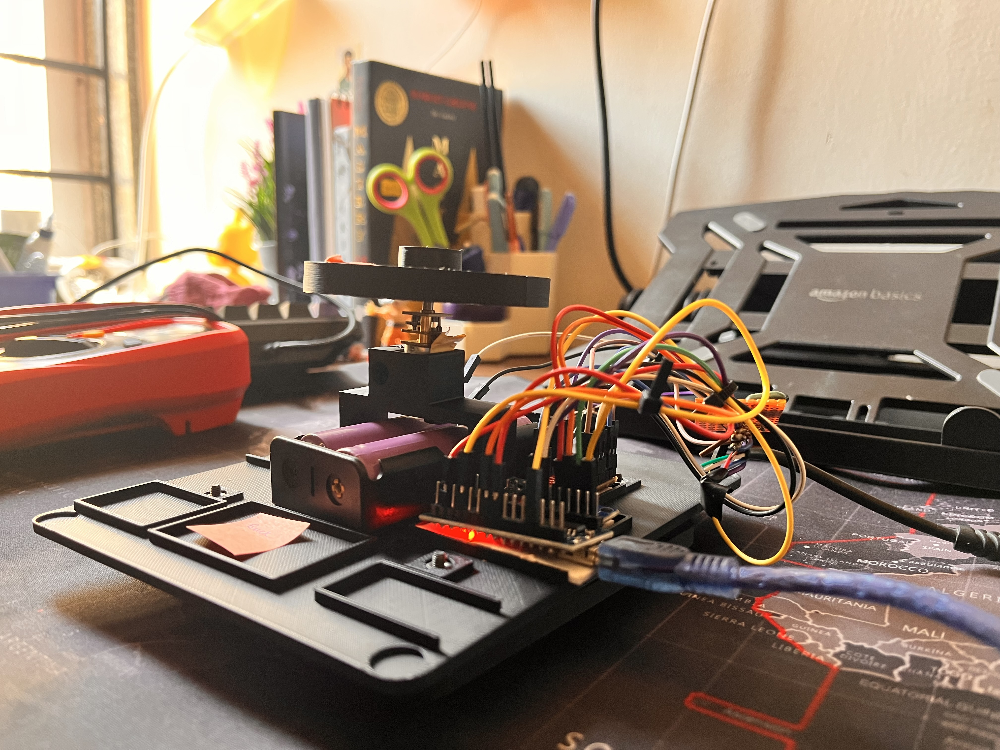

# Momentum-based Attitude Control Simulator (ADCS-1)

EC300 Control Systems, Group 20, NIT Goa

**Team:** Kartikey Tiwari, Kathan Kuchekar, Mayuresh Nalavade

[](https://drive.google.com/file/d/1wtIBcwjpKxcyAmiBpySV5_8BWWvSLD9M/view?usp=sharing)

**Demo video:** [Watch on drive](https://drive.google.com/file/d/1wtIBcwjpKxcyAmiBpySV5_8BWWvSLD9M/view?usp=sharing)

## Overview
A single-axis attitude control system for a simulated CubeSat. An internal
reaction wheel provides the control torque, so there are no thrusters and no
aerodynamic surfaces. The body is modeled as a double integrator, derived from
conservation of angular momentum between the body and the wheel.

The controller (PD and lead compensator) is designed for a target phase margin
and checked with Bode, root locus and Nyquist analysis. It is then verified in
Python simulation, and finally run on the built hardware.

## Progress
- [x] Phase 0: Specifications
- [x] Phase 1: Mathematical modeling
- [x] Phase 2: PD controller design (Bode, root locus, Nyquist)
- [x] Phase 2b: Lead compensator design (matches target PM exactly)
- [x] Phase 3: Python simulation (step response, disturbance rejection, 2-DOF prefilter)
- [x] Phase 4: Hardware build
- [x] Phase 5: Firmware
- [ ] Phase 6: Kalman filter, friction feedforward, saturation demo

## Plant Model
G(s) = 1 / (J_b s²), derived from conservation of angular momentum between
the body (J_b) and the reaction wheel (J_w).

| Parameter | Value | Status |
|---|---|---|
| J_b (body inertia) | YOUR_MEASURED_VALUE kg·m² | measured by bifilar pendulum (simulation used 2×10⁻³ as a placeholder) |
| J_w (flywheel inertia) | YOUR_VALUE kg·m² | steel nut flywheel |

## Controller Design
| Controller | Parameters | Achieved PM |
|---|---|---|
| PD | K_p=0.01633, K_d=0.008 | 65.2° at 4.41 rad/s |
| Lead | z=1.608, p=22.39, K=0.269 | 60.0° at 6.00 rad/s (exact) |

The lead compensator is the practical version of the PD: its gain flattens at
high frequency instead of growing without bound, which keeps gyro noise out of
the motor command.

## Simulation Results
| Design | Rise (s) | Settle (s) | Overshoot | Disturbance SS error |
|---|---|---|---|---|
| PD (raw) | 0.297 | 1.709 | 21.0% | 7.02° |
| PD + prefilter | 0.745 | 2.094 | 4.6% | 7.02° |
| Lead (raw) | 0.197 | 1.614 | 18.8% | 5.94° |
| **Lead + prefilter (final)** | 0.980 | 1.797 | **0.0%** | **5.94°** |

**Key finding:** raw PD and lead step responses overshoot more than 2nd-order
theory predicts, because the closed-loop reference transfer function inherits
the controller's own zero. A 2-DOF reference prefilter fixes this. It only
touches the reference path, so stability margins and disturbance rejection
are unchanged.

| Step response | Disturbance rejection |
|---|---|
|  |  |

More plots (Bode, root locus, Nyquist, damping effect) are in [`docs/plots/`](docs/plots/).

## Hardware
| Part | Details |
|---|---|
| Microcontroller | YOUR_BOARD |
| IMU | MPU-6050 |
| Motor driver | DRV8833 |
| Reaction wheel motor | DC motor with a steel nut flywheel |
| Bearing | Lazy susan, 96 × 96 × 8 mm, 55 mm center opening |
| Power | 2 × 18650 (2S) with LM2596 buck converter |
| Structure | 3D printed in PLA, parametric OpenSCAD |


Wiring: [`hardware/electronics/`]


### 3D designs
All mechanical parts are written in OpenSCAD, so every dimension is a
parameter.

## Firmware
Arduino code in [`firmware/adcs1/`](firmware/adcs1/). It reads the MPU-6050,
estimates angle with a complementary filter, runs the PD loop at a fixed rate
and drives the wheel through the DRV8833.

Board, libraries, pin map and upload steps are in [`firmware/README.md`](firmware/README.md).

Test sketches for the motor, the IMU and the bifilar pendulum measurement
are in [`firmware/tests/`](firmware/tests/).

## Hardware Results
| Test | Simulation | Hardware |
|---|---|---|
| 10° step, overshoot | 0.0% | 0.8% |
| 10° step, settling time | 1.797 s | 2.098s |
| Constant disturbance, steady-state error | 5.94° | 9.79° |

## Repo layout
```
analysis/     plant modeling, PD and lead design, Bode / root locus / Nyquist
sim/          closed-loop simulation, step response, disturbance rejection
firmware/     Arduino code and test sketches
hardware/     CAD (OpenSCAD and STL), electronics, BOM
docs/         report, generated plots, photos and demo media
```

## Setup

### Python (analysis and simulation), WSL/Linux
```bash
python3 -m venv venv
source venv/bin/activate
pip install -r requirements.txt
cd analysis && python controller_design.py
cd ../sim && python step_and_disturbance.py
```
Run each script from its own folder. Plots are saved to `docs/plots/`.

### Firmware
1. Open `firmware/adcs1/adcs1.ino` in the Arduino IDE.
2. Install the libraries listed in `firmware/README.md`.
3. Select the board and port, then upload.

## Docs
- [Project abstract](docs/report/ADCS-1_Abstract.pdf)
- [Plots](docs/plots/)
- [Photos and demo media](https://drive.google.com/file/d/1wtIBcwjpKxcyAmiBpySV5_8BWWvSLD9M/view?usp=sharing)

## Team
- Kartikey Tiwari (24ECE1020)
- Kathan Kuchekar (24ECE1022)
- Mayuresh Nalavade (24ECE1053)

Instructor: Pragati Patel
